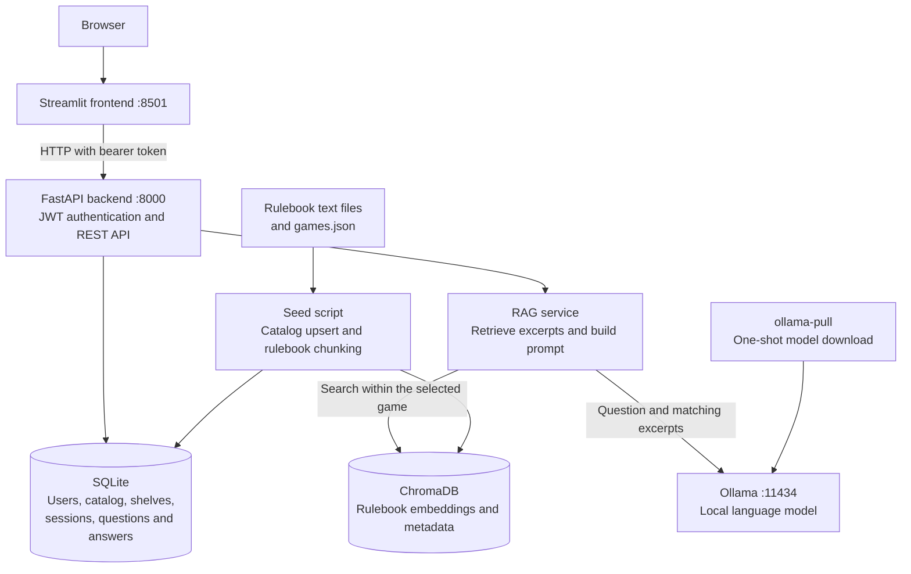

# RuleKeepr

**RuleKeepr knows the rules, so you can rule the game.**

A self-hosted board game companion for organizing your gameshelf, tracking play
sessions, and asking rules questions against a game's rulebook. Answers use
retrieval-augmented generation (RAG) with ChromaDB and a local Ollama model.

## Features

- Register and log in to your own account.
- Add games from a shared catalog to your personal gameshelf.
- Filter your shelf by player count, minimum rating, and average game length.
- Start and end play sessions, watch a live timer, and track time played.
- Save session notes and rate games in quarter-star increments.
- Ask rules questions during active sessions and inspect supporting excerpts.
- View dashboard statistics and a play log.

The bundled catalog includes Monopoly, Scrabble, Scattergories, Settlers of Catan,
Camel Up, Cribbage, and Sky Team.

## Architecture



### How a question is answered

1. The backend verifies that the user owns the selected play session and that it
   has not ended.
2. The question is saved in SQLite before answer generation begins.
3. ChromaDB retrieves relevant chunks from that game's rulebook.
4. The RAG service filters weak matches and sends the remaining excerpts and
   question to Ollama. With no suitable matches, it returns a not-covered message.
5. The generated answer is saved in SQLite and returned with its source excerpts.

The model is instructed to answer only from the excerpts, but generated answers
can still be wrong. Check the sources when resolving a disputed rule.

Question and answer text persist; source excerpts are cached only in the current
Streamlit session, not stored with question history. Each question is answered
independently: previous chat messages are not included in the model prompt.

## Setup with Docker Compose

### Prerequisites

- Git and Docker with the Compose v2 plugin, or Docker Desktop.
- Ports **8000** and **8501** available on your machine.
- Enough memory and disk space for the selected Ollama model. The default,
  `qwen2.5:14b`, is a substantial download and can be slow on CPU-only machines.
- Internet access for the initial container builds, model pull, and embedding
  model download.

### 1. Clone and configure

```bash
git clone https://github.com/willbear24/RuleKeepr.git
cd RuleKeepr
cp .env.example .env
```

Generate a signing secret:

```bash
python3 -c "import secrets; print(secrets.token_hex(32))"
```

Edit `.env` and replace `JWT_SECRET=change-me` with that value. Keep `.env`
private and do not commit it.

To use a smaller model, also change `LLM_MODEL`, for example:

```dotenv
LLM_MODEL=qwen2.5:7b
```

### 2. Build and start

Run all commands from the repository root:

```bash
docker compose up --build -d
docker compose ps -a
docker compose logs -f ollama-pull
```

Compose starts ChromaDB and Ollama, then downloads the configured model through
the one-shot `ollama-pull` service. The backend waits for that job to finish
successfully; the frontend waits for the backend health check.

An exited `ollama-pull` container with exit code `0` is expected. The first
startup can take a while. Pressing Ctrl+C while following logs stops the log
viewer, not the containers.

### 3. Seed the catalog and rulebooks

Once the backend is running:

```bash
docker compose exec backend python -m backend.scripts.seed_games
```

**This is required on a fresh installation.** Starting the API creates database
tables but does not populate the catalog or ingest rulebooks.

Look for both a `Seeded games:` summary and an `Ingested ... chunks` summary.
The script saves catalog entries before ingestion, so an ingestion warning can
leave visible games without searchable rules. Fix the service issue and rerun
the same command. Existing catalog entries are updated and each game's chunks
are replaced, so reseeding does not duplicate them.

### 4. Open RuleKeepr

| Resource | URL |
| --- | --- |
| Application | <http://localhost:8501> |
| Interactive API documentation | <http://localhost:8000/docs> |
| API/database health check | <http://localhost:8000/health> |

ChromaDB and Ollama are available to the backend on the Compose network; the
provided configuration does not publish their ports to the host.

### Stop, restart, and persistence

```bash
# Stop and remove containers, retaining saved data.
docker compose down

# Start again with the existing data and downloaded model.
docker compose up -d

# Inspect application logs.
docker compose logs -f backend frontend
```

Named volumes retain:

| Volume | Contents |
| --- | --- |
| `sqlite_data` | Accounts, catalog, shelves, play sessions, questions, and answers |
| `chroma_data` | Indexed rulebook chunks and embeddings |
| `ollama_models` | Downloaded language models |

Do not use `docker compose down -v` unless you intend to delete these volumes and
their data. Back up persistent data before destructive operations.

## Usage guide

### Create an account and add games

1. Open **Home** and register with your name, email, and a password of at least
   eight characters. Existing users can use the **Login** tab.
2. Under **Add a game to your Gameshelf**, select **Add Game** for a catalog game.
3. Review your dashboard for games owned, sessions logged, active sessions, most
   played game, and total time played.

Registration currently simulates a welcome email by writing a server-side log;
it does not send real email.

### Manage your gameshelf

Open **My Gameshelf** from the navigation:

- Filter by player count, rating, or maximum average game length.
- The rating filter is a minimum; unrated games remain visible.
- The length slider at its maximum means no length limit.
- Select **Start Session** to begin playing and open the Play Log.
- Select **End session** to stop an active session.

**Removing a game also permanently deletes your play sessions and questions for
that game.** A confirmation dialog appears before removal. Other users' shelves
and the shared catalog are unaffected.

### Ask a rules question

1. Start a session for the game from **My Gameshelf**.
2. Open **Ask RuleKeepr**, or follow the link from an active session in **Play Log**.
3. Choose the correct active session in the **Play session** selector.
4. Enter a specific question, such as "What happens when I pass Go?"
5. Expand **Sources** beneath the answer to review matching rulebook excerpts.

Questions are limited to 2,000 characters and can only be asked in active
sessions. The first answer may be slower while Ollama loads the model.

If generation fails, the question may already be saved without an answer. The
page refreshes history and displays a warning; check it before submitting again
to avoid duplicates. After a timeout, the backend may still finish processing.
Saved answers remain available through the API after a session ends, but the
current chat page only lists active sessions.

### Finish a session and save notes

In **Play Log**:

- Switch between **In Progress** and **Finished**, or filter by game.
- Save session notes of up to 2,000 characters.
- End an active session to record its duration.
- On a finished session, rate the game from 0.25 to 5 stars in 0.25 increments;
  select 0 to clear its rating.

Ratings belong to the game on your shelf, not to an individual session.

If your login expires, return to **Home**, log out, and log back in.

## Local development

The containers use Python 3.11. The following commands use a POSIX shell and run
from the repository root. Start with the `.env` setup above.

### Install Python dependencies

```bash
python3.11 -m venv .venv
source .venv/bin/activate
python -m pip install -r backend/requirements.txt -r frontend/requirements.txt
```

### Start local backing services

Install Ollama separately, start its server, and pull the same model configured
in `.env`:

```bash
# In a separate terminal, if Ollama is not already running:
ollama serve

# Once its server is running:
ollama pull qwen2.5:14b
```

Run ChromaDB on a different port from FastAPI:

```bash
chroma run --path ./chroma_data --port 8001
```

For local development, add these values to `.env`:

```dotenv
CHROMA_HOST=localhost
CHROMA_PORT=8001
OLLAMA_URL=http://localhost:11434
DATABASE_URL=sqlite:///./app.db
```

The frontend defaults to `http://localhost:8000`. Set the `BACKEND_URL`
environment variable when starting Streamlit if the API runs elsewhere.

### Seed and run the application

With the virtual environment activated in each terminal:

```bash
python -m backend.scripts.seed_games
python -m uvicorn backend.app.main:app --reload --port 8000
```

In another terminal:

```bash
source .venv/bin/activate
python -m streamlit run frontend/Home.py
```

### Run tests

Keep a valid `JWT_SECRET` in `.env`, or set one for the test process. From the
repository root:

```bash
python -m pytest -q backend/tests frontend/test_error_handling.py
```

Backend tests use an isolated in-memory SQLite database. Retrieval and answer
generation tests use mocks rather than requiring running ChromaDB or Ollama
services. Frontend error-handling tests exercise the pages with Streamlit AppTest.

## Configuration

The backend reads `.env` from its working directory, with environment variables
taking precedence. Compose explicitly supplies container settings from
[docker-compose.yml](./docker-compose.yml); local `.env` host values do not
override those container service addresses.

| Variable | Local default | Purpose |
| --- | --- | --- |
| `JWT_SECRET` | Required | Signs access tokens; replace the example placeholder |
| `JWT_ALGORITHM` | `HS256` | JWT signing algorithm |
| `ACCESS_TOKEN_EXPIRE_MINUTES` | `60` | Access token lifetime |
| `DATABASE_URL` | `sqlite:///./app.db` | SQLAlchemy database URL |
| `CHROMA_HOST` | `localhost` | ChromaDB server host |
| `CHROMA_PORT` | `8000` | ChromaDB port; use `8001` for the local setup above |
| `OLLAMA_URL` | `http://localhost:11434` | Ollama server URL |
| `LLM_MODEL` | `qwen2.5:14b` | Model used for answer generation |
| `BACKEND_URL` | `http://localhost:8000` | Frontend API URL, read from its process environment |

## Adding a game or updating rules

1. Add a UTF-8 rulebook `.txt` file under
   [backend/data/rulebooks](./backend/data/rulebooks/). Use short uppercase section
   headings and blank lines between paragraphs to help the chunker preserve
   meaningful sections.
2. Add or update its entry in
   [games.json](./backend/data/rulebooks/games.json), including `title`,
   `min_player`, `max_player`, `play_time_minutes`, and `rules_filename`.
3. Optionally add cover art under [frontend/assets/games](./frontend/assets/games/).
   Name it after the lowercase title with spaces replaced by underscores;
   `.png`, `.jpg`, `.jpeg`, and `.webp` are supported.
4. Rerun the seed script. For Docker, rebuild the backend first so it includes
   the updated files:

   ```bash
   docker compose up --build -d backend
   docker compose exec backend python -m backend.scripts.seed_games
   ```

Rebuild the frontend as well if you changed its bundled images.

## Troubleshooting

| Symptom | What to check |
| --- | --- |
| Backend or frontend has not started | Inspect `docker compose ps -a` and `docker compose logs ollama-pull backend`. The initial model pull must finish before the backend starts. |
| Catalog is empty | Run the seed command after the backend starts. |
| Games appear but rules are not found | Check the seed output for ingestion warnings, verify ChromaDB is running, and rerun ingestion. A not-covered response can also mean the excerpts do not address the question. |
| Language model unavailable | Check Ollama logs, confirm the configured model was pulled, and verify `OLLAMA_URL` points to the correct server. |
| Rulebook search unavailable | Check ChromaDB logs and the backend's `CHROMA_HOST`/`CHROMA_PORT`. |
| Server took too long to respond | Model loading or CPU generation may be slow. Check question history before retrying and consider a smaller model. |
| Invalid or expired token | Log out from Home and log back in. |
| Too many requests | Wait before retrying; API endpoints apply per-client rate limits. |
| Local ChromaDB conflicts with FastAPI | Use port `8001` for ChromaDB and `8000` for FastAPI, as shown above. |

The `/health` endpoint checks the API's database connection, not ChromaDB
retrieval or Ollama generation. A healthy API does not guarantee rules answers
are available.

The supplied Compose setup is intended for local/self-hosted use. Before
exposing it publicly, add HTTPS, review network access, and establish backups and
deployment-specific operational safeguards.